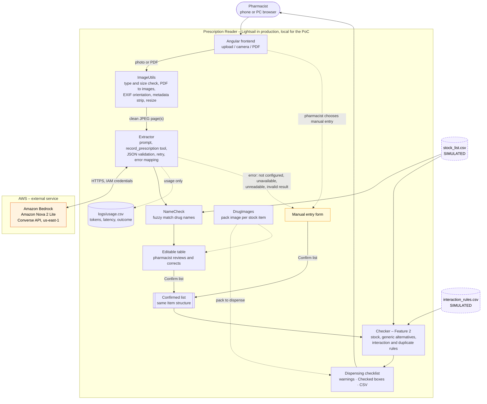

# Architecture

Prescription Reader – IT6070 Assignment II (U.W.D.P. Amarasinghe, MS25903874)

## Overview

The pharmacist photographs (or uploads a PDF of) a handwritten prescription in a browser on a phone or PC.
The Angular frontend sends it to the Spring Boot backend, which checks the file, removes all metadata, resizes it
and sends it to **Amazon Nova 2 Lite on Amazon Bedrock**. Nova returns the items as structured JSON. The backend
validates them, flags low-confidence fields and unknown drug names, and the pharmacist reviews and corrects them in an
editable table. The **confirmed list** – from the AI path or the manual-entry path, in the same `Item` structure – is
the input to the dispensing check (Feature 2), which compares it with the stock list and the interaction rules.

For the proof of concept everything runs locally on the student's laptop; only the Bedrock call leaves the machine.
In production the backend and frontend would run on one **AWS Lightsail** instance.

**Legend:** orange = external AWS service (Amazon Bedrock) · purple dashed = **simulated** data (CSV files, not a
clinical database) · yellow = manual-entry fallback · dotted arrows =
fallback and logging paths.

## Components

| Component | Source | Role |
|-----------|--------|------|
| Angular frontend | `frontend/src/app/` | Upload/camera/PDF, editable table beside the photo, low-confidence warnings, manual entry, confirm; dashboard, history, settings |
| REST API | `backend/.../api/PrescriptionController.java` | `/api/scans`, `/api/preview`, `/api/name-check`, `/api/name-suggestions`, `/api/prescriptions`, `/api/dashboard` |
| ImageUtils | `backend/.../image/ImageUtils.java` | Accepts JPG/PNG/WEBP/PDF ≤ 10 MB; PDF pages (≤ 3) rendered to images; EXIF orientation; **all metadata removed**; longest side ≤ 1600 px; JPEG |
| Extractor | `backend/.../extractor/Extractor.java` | Bedrock Converse call with the image(s) + prompt, temperature 0, forced `record_prescription` tool (text-JSON fallback), one retry on invalid output, AWS errors mapped to the five error types |
| NameCheck | `backend/.../namecheck/NameCheck.java` | Fuzzy match (WRatio ≥ 85) against brand and generic names; unknown names flagged low confidence |
| Usage log | `backend/.../history/UsageLog.java` | One row per scan in `logs/usage.csv`: outcome, item counts, input/output tokens, latency – the measured input to `scripts/cost_estimate.py` |
| Confirmed store | `backend/.../history/ConfirmedStore.java` | Confirmed drug lists (no patient details) in `logs/confirmed.jsonl` |
| Checker (Feature 2) | `backend/.../checker/Checker.java`, `api/CheckController.java` | Resolves each confirmed item with the same matcher as NameCheck; stock status; in-stock alternatives with the same generic (same strength first); interaction, duplicate-class and duplicate-ingredient rules; unmatched items warned ("not checked"); strength mismatches noted. `POST /api/check` |
| DrugImages | `backend/.../image/DrugImages.java` | `GET /api/stock/{id}/image`: the pharmacy's own photo from `data/drug_images/<id>.jpg` if present, otherwise a generated, labelled illustration (brand, generic, strength, colour by form). Shown as the "pack to dispense" in the checklist and under matched names in the review table |
| Amazon Bedrock | AWS, external | Amazon Nova 2 Lite via the `us.amazon.nova-2-lite-v1:0` inference profile; model ID is a setting (`BEDROCK_MODEL_ID`) |
| Stock list, rules | `data/*.csv` | **Simulated** proof-of-concept data |

## Data flow and privacy

1. The upload is held in memory only (`spring.servlet.multipart.file-size-threshold=11MB`); it is never written to disk.
   *Optional:* with `KEEP_IMAGES=true` (off by default) the **processed** image (step 2's output) of a list the pharmacist
   **confirms** is saved to `logs/scan-images/` (git-ignored) so History can show it, and deleted automatically after
   `IMAGE_RETENTION_DAYS` (default 7) or on request. Unconfirmed scans are dropped from memory after 30 minutes.
2. Before anything is sent to AWS, the image is decoded and re-encoded from pixels, so EXIF/GPS data, PDF metadata and
   any PDF text layer are not transmitted – only the visible page image.
3. The prompt tells the model to ignore the patient's name, address and age and the doctor's details, and the
   response schema has no field for them, so they are never returned or stored.
4. Only drug items, token counts and timings are logged (`logs/`, git-ignored).
5. The backend authenticates to Bedrock with a least-privilege IAM user (`bedrock:InvokeModel` on Nova only) through
   the standard AWS credentials chain; no key is in the code or repository.
6. The image does cross to an overseas AWS region (us-east-1) – see [feasibility.md](feasibility.md) for the privacy
   assessment.

## Failure paths

| Failure | Detected by | What the user sees |
|---------|-------------|--------------------|
| Wrong type, > 10 MB, corrupt, > 3 PDF pages, password-protected PDF | ImageUtils | Reason shown; choose another file |
| No credentials, access denied, invalid model ID | Extractor → `ConfigError` | "AI not configured … – using manual entry" |
| Network error, timeout, throttling, Bedrock server error | Extractor → `AIUnavailableError` | "AI service unavailable – using manual entry" |
| Model says nothing readable | Extractor → `UnreadableImageError` | "Could not read this photo – please retake it, or enter the items manually" |
| Output not valid JSON twice, or Bedrock `ModelErrorException` twice | Extractor → `InvalidResponseError` | "AI returned an unexpected result – using manual entry" |
| Stock list or rules missing / malformed | DataLoader → `DataError` | "Stock/rule data unavailable" – the confirmed list is still shown; the app still starts |

In every AI failure case the app switches to the manual-entry form, which produces the same confirmed list, so the
dispensing check always remains available.

## Deployment

| | Proof of concept (now) | Production (proposed) |
|---|---|---|
| Host | Student laptop: `mvn spring-boot:run` + `ng serve` | One AWS Lightsail Linux instance (backend serves the built Angular app) behind HTTPS |
| AI | Amazon Bedrock, us-east-1, Nova 2 Lite | Same; region choice reviewed in the feasibility study |
| Data | Simulated CSVs | Pharmacy's real stock list (export from its stock system) |
| Access | Local only, no login | Pharmacy network / login to be added before real use |
